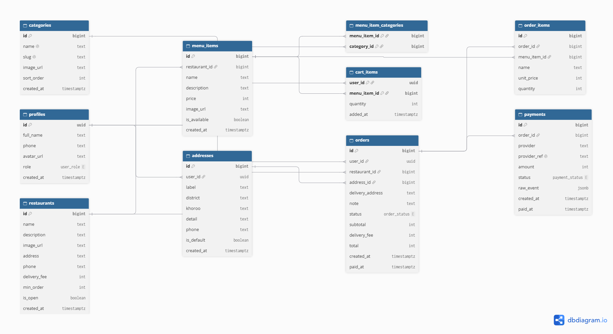

# FoodGo 🍔 — Онлайн хоол хүргэлт

SWE334 Интернет програмчлал · Улирлын бие даалтын төсөл

## Асуудал
Улаанбаатарын олон ресторан захиалгаа утсаар эсвэл Facebook Messenger-ээр авдаг.
Хэрэглэгч шинэчлэгдсэн цэс, үнийг харж чаддаггүй, төлбөрийг дэлгэцийн зургаар гараар шалгадаг,
захиалга хаана явааг мэддэггүй.

## Шийдэл
Хэрэглэгч ресторан, хоолоо хайж, шүүж, захиалж, онлайнаар төлдөг вэб систем.
Админ ресторан, хоолны цэс, захиалгыг удирдана.

## Хэрэглэгчийн төрөл
| Төрөл | Боломж |
|---|---|
| Зочин | Ресторан, цэс үзэх; нэр, ангилал, үнээр хайх, шүүх, эрэмбэлэх, хуудаслах |
| Хэрэглэгч | Бүртгүүлэх, нэвтрэх, гарах, нууц үг сэргээх, профайл (сагс, захиалга, төлбөр: Хамгаалалт-2) |
| Админ | Хоол нэмэх, засах, устгах, зураг оруулах, админ самбар |

## Технологи
- **Frontend:** React + JavaScript (Vite), React Router, Tailwind CSS, react-hot-toast
- **Backend:** Supabase (Auth, PostgreSQL, Storage, Row Level Security)
- **Төлбөр (Хамгаалалт-2):** Stripe тест орчин + webhook (Supabase Edge Functions)
- **Байршуулалт (Хамгаалалт-2):** GitHub + Vercel + өөрийн домэйн

## Өгөгдлийн сан
10 хүснэгт, 1:N болон N:M холбоотой. Бүх хүснэгтэд RLS идэвхтэй.



- ERD код: [`docs/erd.dbml`](docs/erd.dbml)
- dbdiagram: https://dbdiagram.io/d/FoodGo-ERD-6af13db17ded3580faea9ece
- Wireframe: ХОЛБООСОО_ЭНД_ТАВЬ

## Суулгах заавар (local)
1. Репог татаж, сангуудыг суулгана
   ```bash
   git clone https://github.com/b20fa1759-glitch/food-delivery.git
   cd food-delivery
   npm install
   ```
2. Supabase төсөл үүсгээд **SQL Editor**-т дараах файлуудыг дарааллаар ажиллуулна:
   `001_schema.sql` → `002_rls.sql` → `003_functions.sql` → `004_storage.sql` → `seed.sql` → `005_translate_mn.sql`
3. `.env.example`-ийг `.env` нэрээр хуулж, Supabase-ийн **Project URL** болон **publishable (anon) key**-ийг бөглөнө
   ```
   VITE_SUPABASE_URL=
   VITE_SUPABASE_ANON_KEY=
   ```
4. Аппыг асаана
   ```bash
   npm run dev
   ```
   http://localhost:5173 хаягаар нээнэ.
5. Админ эрх олгох: аппад бүртгүүлээд SQL Editor-т
   ```sql
   update public.profiles set role = 'admin'
   where id = (select id from auth.users where email = 'ТАНЫ_ИМЭЙЛ');
   ```

## Аюулгүй байдал
- Бүх хүснэгтэд RLS: хэрэглэгч зөвхөн өөрийн өгөгдлийг харж, өөрчилнө; цэсийг зөвхөн админ өөрчилнө
- Захиалгын үнийг серверийн SQL функц (`create_order_from_cart`) тооцоолно
- Frontend-д зөвхөн publishable (anon) key ашигласан; `.env` нь `.gitignore`-д байгаа
- `service_role` түлхүүр frontend код болон репод байхгүй

## Тэмдэглэл
Сургалтын төсөл. Ресторануудын нэрийг жишээ болгон ашигласан бөгөөд тэдгээр компанитай холбоогүй. Үнэ, цэс бодит биш.
